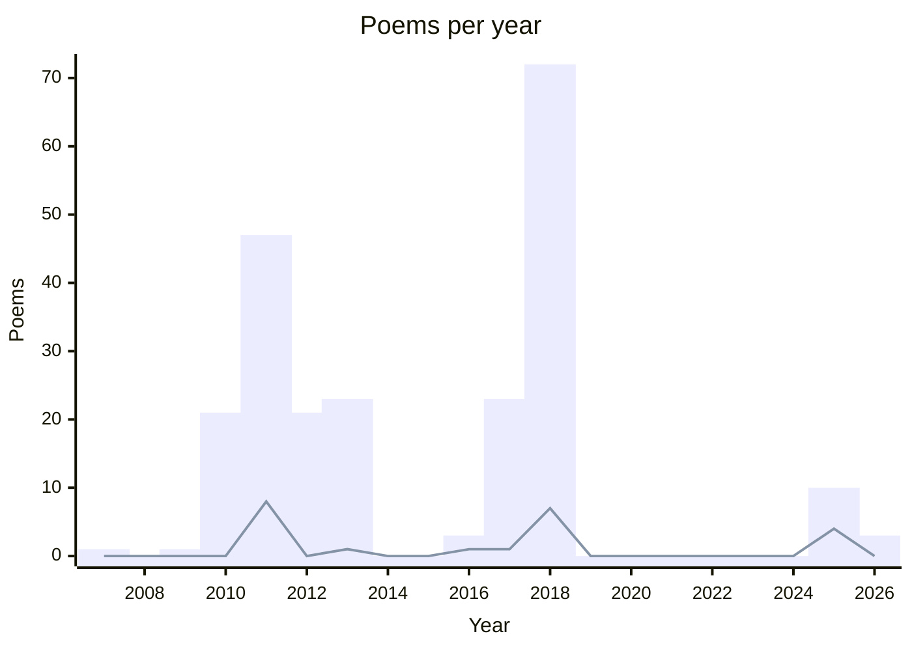
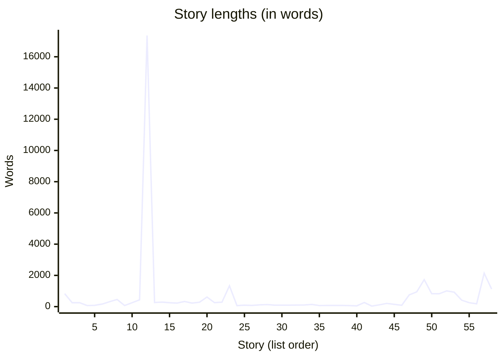

## 💌 Poems

[Browse all poems](@/tell/poems/_index.md)

### Summary

**Total:** 225  
**Drafts:** 18  
**Favourites:** 22  
**Languages:**

- English 🇬🇧: 8
- French 🇫🇷: 216
- Unspecified: 1

Bars: poems per year. Line: favourites per year.

### Poem list

✂︎ Draft · ⭐ Favourite

#### 2026

- [Joie de la découverte](@/tell/poems/2026-01-30-joie-de-la-decouverte.md)
- [Deuxième passage](@/tell/poems/2026-01-30-deuxieme-passage.md)
- [Ligne 1](@/tell/poems/2026-01-29-ligne-1.md)

#### 2025

- [Carte postale n° 2](@/tell/poems/2025-08-09-carte-postale-2.md)
- [Carte postale n° 1](@/tell/poems/2025-08-01-carte-postale-1.md)
- [The wind is all I need](@/tell/poems/2025-07-29-the-wind-is-all-i-need.md) ⭐
- [With you](@/tell/poems/2025-with-you.md) ✂︎
- [Simple life](@/tell/poems/2025-simple-life.md) ⭐
- [Parle-moi](@/tell/poems/2025-parle-moi.md) ✂︎
- [Horaire de danse ?](@/tell/poems/2025-horaire-de-danse.md)
- [Fais-moi plaisir](@/tell/poems/2025-fais-moi-plaisir.md) ✂︎ ⭐
- [Euphonie](@/tell/poems/2025-euphonie.md) ⭐
- [A cat in the corner](@/tell/poems/2025-cat-corner.md) ✂︎

#### 2018

- [Ego](@/tell/poems/2018-08-01-ego.md)
- [Description Tinder](@/tell/poems/2018-08-14-description-tinder.md)
- [Rime](@/tell/poems/2018-09-08-rime.md)
- [Civil](@/tell/poems/2018-08-08-civil.md)
- [Contemporain](@/tell/poems/2018-08-07-contemporain.md)
- [Aride](@/tell/poems/2018-08-06-aride.md)
- [9 h 15](@/tell/poems/2018-08-06-9-h-15.md)
- [_Mea Culpa_](@/tell/poems/2018-08-05-mea-culpa.md)
- [Richard](@/tell/poems/2018-07-30-richard.md)
- [Pavé](@/tell/poems/2018-07-29-pave.md) ⭐
- [Lire](@/tell/poems/2018-07-29-lire.md)
- [La haine en mon corps](@/tell/poems/2018-07-29-la-haine-en-mon-corps.md)
- [Bûcher](@/tell/poems/2018-07-29-bucher.md)
- [Au pays](@/tell/poems/2018-07-29-au-pays.md)
- [Orties](@/tell/poems/2018-07-27-orties.md)
- [Si mes propos](@/tell/poems/2018-07-26-si-mes-propos.md)
- [En Marche](@/tell/poems/2018-07-26-en-marche.md)
- [Éducateurs](@/tell/poems/2018-07-26-educateurs.md)
- [Trope](@/tell/poems/2018-07-25-trope.md)
- [Jour et Nuit](@/tell/poems/2018-07-24-jour-et-nuit.md)
- [Lapsus](@/tell/poems/2018-07-23-lapsus.md)
- [Voilà](@/tell/poems/2018-07-22-voila.md)
- [S’il vous plait](@/tell/poems/2018-07-22-s-il-vous-plait.md)
- [Princes & Princesses](@/tell/poems/2018-07-22-princes-et-princesses.md)
- [Scribe](@/tell/poems/2018-07-21-scribe.md)
- [Intègre](@/tell/poems/2018-07-20-integre.md)
- [Délicatesse masculine](@/tell/poems/2018-07-19-delicatesse-masculine.md)
- [Invalides](@/tell/poems/2018-07-18-invalides.md)
- [Train](@/tell/poems/2018-07-17-train.md) ⭐
- [Affirmation](@/tell/poems/2018-07-16-affirmation.md)
- [Attention](@/tell/poems/2018-07-15-attention.md)
- [Hantise](@/tell/poems/2018-07-14-hantise.md)
- [Nocent](@/tell/poems/2018-07-13-nocent.md)
- [Joséphine](@/tell/poems/2018-07-12-josephine.md)
- [Chauve-Souris](@/tell/poems/2018-07-11-chauve-souris.md)
- [Peux-tu ?](@/tell/poems/2018-07-10-peux-tu.md)
- [Je voulais seulement](@/tell/poems/2018-07-08-je-voulais-seulement.md)
- [Motivation](@/tell/poems/2018-04-13-motivation.md)
- [Chemin](@/tell/poems/2018-01-17-chemin.md)
- [Soyons ivres toujours](@/tell/poems/2018-soyons-ivre-toujours.md) ✂︎
- [Silence](@/tell/poems/2018-silence.md) ⭐
- [Si je devais être pris de court](@/tell/poems/2018-si-je-devais-etre-pris-de-court.md)
- [Seul comme dans un terminus](@/tell/poems/2018-seul-comme-dans-un-terminus.md) ✂︎
- [Santé !](@/tell/poems/2018-sante.md)
- [Saint Jean](@/tell/poems/2018-saint-jean.md) ⭐
- [Retour au bercail](@/tell/poems/2018-retour-au-bercail.md)
- [Quelques briques](@/tell/poems/2018-quelques-briques.md) ✂︎
- [Que veux-tu que je te dise ?](@/tell/poems/2018-que-veux-tu-que-je-te-dise.md) ✂︎
- [Pardonne-moi, pardonne-nous](@/tell/poems/2018-pardonne-moi.md)
- [On lit mes petits vers](@/tell/poems/2018-on-lit-mes-petits-vers.md) ✂︎
- [Ma Réputation](@/tell/poems/2018-ma-reputation.md)
- [Ma barbe me gratte](@/tell/poems/2018-ma-barbe-me-gratte.md) ✂︎
- [Léger syndrome de la page blanche](@/tell/poems/2018-leger-syndrome-de-la-page-blanche.md) ✂︎
- [La Victoire de Samothrace](@/tell/poems/2018-la-victoire-de-samothrace.md) ⭐
- [La Politique](@/tell/poems/2018-la-politique.md)
- [La page blanche, c'est celle des débuts](@/tell/poems/2018-la-page-blanche.md) ✂︎
- [Journée sombre](@/tell/poems/2018-journee-sombre.md)
- [Je te demande pardon](@/tell/poems/2018-je-te-demande-pardon.md) ✂︎
- [Je suis fumasse](@/tell/poems/2018-je-suis-fumasse.md)
- [J'aime être en colère](@/tell/poems/2018-j-aime-etre-en-colere.md) ⭐
- [J'ai quitté la campagne](@/tell/poems/2018-j-ai-quitte-la-campagne.md)
- [Gentils](@/tell/poems/2018-gentils.md)
- [Entre le train](@/tell/poems/2018-entre-le-train.md)
- [Écrire quelques mots pour un frère](@/tell/poems/2018-ecrire-quelques-mots-pour-un-frere.md) ⭐
- [Demoiselles mondaines](@/tell/poems/2018-demoiselles-mondaines.md)
- [Coup de pied au derrière](@/tell/poems/2018-coup-de-pied.md)
- [Bien chère demoiselle](@/tell/poems/2018-bien-chere-demoiselle.md) ✂︎
- [Belle Hirondelle](@/tell/poems/2018-belle-hirondelle.md) ✂︎
- [Aujourd'hui est un grand jour](@/tell/poems/2018-aujourd-hui-est-un-grand-jour.md) ✂︎
- [Appelle-moi, dis-moi n'importe quoi](@/tell/poems/2018-appelle-moi.md)
- [Ah ! Voilà qui est dur](@/tell/poems/2018-ah-voila-qui-est-dur.md) ✂︎
- [Carnet n°2](@/tell/poems/2018-05-13-carnet-n-2.md)

#### 2017

- [Regret](@/tell/poems/2017-11-27-regret.md)
- [Remords](@/tell/poems/2017-11-26-remord.md)
- [Le regret et le remords](@/tell/poems/2017-11-25-le-regret-et-le-remord.md)
- [Follow](@/tell/poems/2017-11-18-follow.md)
- [Silence](@/tell/poems/2017-11-17-silence.md)
- [Rempart](@/tell/poems/2017-11-13-rempart.md)
- [Discipline](@/tell/poems/2017-11-11-discipline.md)
- [Touché](@/tell/poems/2017-11-10-touche.md)
- [Inavoué](@/tell/poems/2017-11-09-inavoue.md)
- [Réponse](@/tell/poems/2017-11-07-reponse.md)
- [Auber](@/tell/poems/2017-11-06-auber.md) ⭐
- [Incarnat](@/tell/poems/2017-11-04-incarnat.md)
- [Visages](@/tell/poems/2017-11-01-visages.md)
- [Amitié](@/tell/poems/2017-10-30-amitie.md)
- [Monstres](@/tell/poems/2017-10-28-monstres.md)
- [Mon Horlogère](@/tell/poems/2017-10-23-mon-horlogere.md)
- [Seul](@/tell/poems/2017-10-18-seul.md)
- [La campagne](@/tell/poems/2017-05-20-la-campagne.md)
- [Écrasé, je ne meurs pas](@/tell/poems/2017-05-13-ecrase.md)
- [J'essaye de ne pas y penser](@/tell/poems/2017-05-09-j-essaye-de-ne-pas-y-penser.md)
- [Campagne](@/tell/poems/2017-04-29-campagne.md)
- [Mentir, se mentir](@/tell/poems/2017-04-22-mentir-se-mentir.md)
- [J'ai envie de fuir](@/tell/poems/2017-03-17-j-ai-envie-de-fuir.md)

#### 2016

- [Sur Tinder](@/tell/poems/2016-11-25-sur-tinder.md)
- [Challengez-moi](@/tell/poems/2017-06-11-challengez-moi.md) ⭐
- [Blanc](@/tell/poems/2016-11-22-blanc.md)

#### 2013

- [Vue et Entendue](@/tell/poems/2013-vue-et-entendue.md)
- [Volonté ?](@/tell/poems/2013-volonte.md)
- [Vagabondant](@/tell/poems/2013-vagabondant.md)
- [Universe](@/tell/poems/2013-universe.md)
- [Un tube de colle](@/tell/poems/2013-un-tube-de-colle.md)
- [Suicide in Snow](@/tell/poems/2013-suicide-in-snow.md)
- [Serpentine Gallery](@/tell/poems/2013-serpentine-gallery.md)
- [Rouge Sang](@/tell/poems/2013-rouge-sang.md)
- [Quand je la regarde](@/tell/poems/2013-quand-je-la-regarde.md)
- [Nous héros - _extrait des \[Maudits\](@/tell/stories/les-maudits.md)_](@/tell/poems/2013-nous-heros.md)
- [Mer Grand](@/tell/poems/2013-mer-grand.md)
- [Lille](@/tell/poems/2013-lille.md)
- [Le Travail](@/tell/poems/2013-le-travail.md)
- [Juste une envie de hurler](@/tell/poems/2013-juste-une-envie-de-hurler.md)
- [Humain](@/tell/poems/2013-humain.md)
- [Damoiselles (2)](@/tell/poems/2013-damoiselles-2.md)
- [Damoiselles](@/tell/poems/2013-damoiselles-1.md)
- [Compris](@/tell/poems/2013-compris.md)
- [Citadin](@/tell/poems/2013-citadin.md)
- [Chaque jour, je la rencontre](@/tell/poems/2013-chaque-jour-je-la-rencontre.md)
- [Au milieu d'une foule](@/tell/poems/2013-au-milieu-d-une-foule.md)
- [As your desire](@/tell/poems/2013-as-your-desire.md)
- [À la bonne heure](@/tell/poems/2013-a-la-bonne-heure.md) ⭐

#### 2012

- [Naïvement](@/tell/poems/2012-03-06-naivement.md)
- [Sur des billets - Suite n° 4 - Billet 5000](@/tell/poems/2012-billet-4-5000.md)
- [Sur des billets - Suite n° 3 - Billet 100](@/tell/poems/2012-billet-3-100.md)
- [Sur des billets - Suite n° 2 - Billet 5](@/tell/poems/2012-billet-2-5.md)
- [Sur des billets - Suite n° 2 - Billet 40](@/tell/poems/2012-billet-2-40.md)
- [Sur des billets - Suite n° 2 - Billet 35](@/tell/poems/2012-billet-2-35.md)
- [Sur des billets - Suite n° 2 - Billet 30](@/tell/poems/2012-billet-2-30.md)
- [Sur des billets - Suite n° 2 - Billet 25](@/tell/poems/2012-billet-2-25.md)
- [Sur des billets - Suite n° 2 - Billet 20](@/tell/poems/2012-billet-2-20.md)
- [Sur des billets - Suite n° 2 - Billet 15](@/tell/poems/2012-billet-2-15.md)
- [Sur des billets - Suite n° 2 - Billet 10](@/tell/poems/2012-billet-2-10.md)
- [Sur des billets - Suite n° 1 - Billet 9](@/tell/poems/2012-billet-1-9.md)
- [Sur des billets - Suite n° 1 - Billet 8](@/tell/poems/2012-billet-1-8.md)
- [Sur des billets - Suite n° 1 - Billet 7](@/tell/poems/2012-billet-1-7.md)
- [Sur des billets - Suite n° 1 - Billet 6](@/tell/poems/2012-billet-1-6.md)
- [Sur des billets - Suite n° 1 - Billet 5](@/tell/poems/2012-billet-1-5.md)
- [Sur des billets - Suite n° 1 - Billet 4](@/tell/poems/2012-billet-1-4.md)
- [Sur des billets - Suite n° 1 - Billet 3](@/tell/poems/2012-billet-1-3.md)
- [Sur des billets - Suite n° 1 - Billet 2](@/tell/poems/2012-billet-1-2.md)
- [Sur des billets - Suite n° 1 - Billet 10](@/tell/poems/2012-billet-1-10.md)
- [Sur des billets - Suite n° 1 - Billet 1](@/tell/poems/2012-billet-1-1.md)

#### 2011

- [Liberté chérie](@/tell/poems/2011-12-05-liberte-cherie.md)
- [Infos](@/tell/poems/2011-07-19-infos.md) ⭐
- [Plus classiques sont les réformateurs](@/tell/poems/2011-07-07-plus-classiques.md) ✂︎
- [Immobiles stagnants](@/tell/poems/2011-07-07-immobiles-stagnants.md)
- [Des Visages](@/tell/poems/2011-07-07-des-visages.md)
- [Le Printemps estival](@/tell/poems/2011-06-16-le-printemps-estival.md) ⭐
- [La Mort](@/tell/poems/2011-06-02-la-mort.md)
- [Nettoyage de Printemps](@/tell/poems/2011-06-nettoyage-de-printemps.md)
- [Idée pyromane](@/tell/poems/2011-06-idee-pyromane.md)
- [À quel moment peut-on se dire poète ?](@/tell/poems/2011-06-a-quel-moment.md)
- [La Mouette](@/tell/poems/2011-05-29-la-mouette.md)
- [Vie](@/tell/poems/2011-05-28-vie.md)
- [Le Feu sacré](@/tell/poems/2011-05-28-le-feu-sacre.md)
- [Idem](@/tell/poems/2011-05-28-idem.md)
- [Warning - _imposed tweak on \[Jenny Joseph's Warning\](https://www.scottishpoetrylibrary.org.uk/poem/warning/)_](@/tell/poems/2011-05-24-warning.md) ⭐
- [La Chute reconnaissable](@/tell/poems/2011-04-13-la-chute-reconnaissable.md)
- [Union](@/tell/poems/2011-04-12-union.md)
- [Idées](@/tell/poems/2011-04-11-idees.md)
- [T.A.A.F.](@/tell/poems/2011-04-10-taaf.md)
- [Fuite ensorcelée](@/tell/poems/2011-04-05-fuite-ensorcelee.md)
- [La Facture](@/tell/poems/2011-03-30-la-facture.md)
- [Épicée](@/tell/poems/2011-03-30-epicee.md)
- [Le Poème](@/tell/poems/2011-03-29-le-poeme.md)
- [Perdu](@/tell/poems/2011-03-28-perdu.md)
- [Métamorphose](@/tell/poems/2011-03-23-metamorphose.md)
- [Autres Dessins](@/tell/poems/2011-03-22-autres-dessins.md)
- [Le Temps](@/tell/poems/2011-03-17-le-temps.md)
- [Pollution](@/tell/poems/2011-03-14-pollution.md)
- [Une Semaine](@/tell/poems/2011-03-13-une-semaine.md) ⭐
- [Dessins](@/tell/poems/2011-03-13-dessins.md)
- [Incompréhension](@/tell/poems/2011-03-11-incomprehension.md)
- [Anagramme](@/tell/poems/2011-03-10-anagramme.md)
- [Acrostiche](@/tell/poems/2011-03-10-acrostiche.md)
- [Soleil - _subject chosen by Cyrielle G_](@/tell/poems/2011-03-09-soleil.md) ⭐
- [Sex - _subject chosen by Maxime B_](@/tell/poems/2011-03-08-sex.md) ⭐
- [Désespoir - _subject chosen by Jordy M_](@/tell/poems/2011-03-08-desespoir.md) ⭐
- [Le Rêve](@/tell/poems/2011-03-07-le-reve.md)
- [Limites](@/tell/poems/2011-02-26-limites.md)
- [Choisir](@/tell/poems/2011-02-20-choisir.md)
- [Berthollet](@/tell/poems/2011-02-18-berthollet.md)
- [Paix intérieure](@/tell/poems/2011-02-16-paix-interieure.md) ⭐
- [Espoir et Désespoir](@/tell/poems/2011-02-13-espoir-et-desespoir.md)
- [Le Nain](@/tell/poems/2011-02-09-le-nain.md)
- [Désirs d'ailleurs](@/tell/poems/2011-02-09-desirs-d-ailleurs.md)
- [Écriture différente](@/tell/poems/2011-02-07-ecriture-differente.md)
- [La Bride](@/tell/poems/2011-01-19-la-bride.md)
- [La Maladie](@/tell/poems/2011-01-05-la-maladie.md)

#### 2010

- [La Volonté](@/tell/poems/2010-12-22-la-volonte.md)
- [Les Deux Faces](@/tell/poems/2010-12-02-les-deux-faces.md)
- [Un Pont](@/tell/poems/2010-11-18-un-pont.md)
- [Les Problèmes](@/tell/poems/2010-11-15-les-problemes.md)
- [La Perle et la Coquille](@/tell/poems/2010-11-14-la-perle-et-la-coquille.md)
- [Ombre et Reflet](@/tell/poems/2010-10-27-ombre-et-reflet.md)
- [Le Poète](@/tell/poems/2010-10-27-le-poete.md)
- [In English](@/tell/poems/2010-10-27-in-english.md)
- [L'Immortel Ennemi](@/tell/poems/2010-10-25-l-immortel-ennemi.md)
- [Imaginer](@/tell/poems/2010-10-18-imaginer.md)
- [Les Canapés](@/tell/poems/2010-10-16-les-canapes.md)
- [Un Imbécile](@/tell/poems/2010-10-10-un-imbecile.md)
- [Les Chevaliers voleurs](@/tell/poems/2010-10-10-les-chevaliers-voleurs.md)
- [L'Amour](@/tell/poems/2010-10-10-l-amour.md)
- [L'Écriture au stylo](@/tell/poems/2010-10-03-l-ecriture-au-stylo.md)
- [Écriture](@/tell/poems/2010-10-03-ecriture.md)
- [Dieu](@/tell/poems/2010-10-03-dieu.md)
- [Hésitation](@/tell/poems/2010-09-29-hesitation.md)
- [L'Écriture impossible](@/tell/poems/2010-09-18-l-ecriture-impossible.md)
- [L'Amour aveugle](@/tell/poems/2010-09-18-l-amour-aveugle.md)
- [Les Larmes](@/tell/poems/2009-11-les-larmes.md)

#### 2009

- [Solitude](@/tell/poems/2010-06-solitude.md)

#### 2007

- [Mon amour ma déchirure](@/tell/poems/2007-mon-amour-ma-dechirure.md)

## 📖 Stories

[Browse all stories](@/tell/stories/_index.md)

### Summary

**Total:** 58  
**Drafts:** 9  
**Favourites:** 0  
**Languages:**

- English 🇬🇧: 1
- French 🇫🇷: 57

### Story list

✂︎ Draft · ⭐ Favourite

#### 2025

- [Le papi qui voulait être papa](@/tell/stories/le-papi-qui-voulait-etre-papa.md) ✂︎ (831 words)

#### 2023

- [Rien à déclarer: Deux secondes](@/tell/stories/ras-deux-secondes.md) (250 words)
- [Rien à déclarer: Une minute](@/tell/stories/ras-une-minute.md) (251 words)
- [Shit Story](@/tell/stories/shit-story.md) ✂︎ (69 words)
- [Hard Memory](@/tell/stories/hard-memory.md) ✂︎ (84 words)
- [Rire est interdit](@/tell/stories/rire-est-interdit.md) ✂︎ (163 words)
- [Et ils s'en furent allés](@/tell/stories/et-ils-s-en-furent-alles.md) ✂︎ (317 words)

#### 2020

- [Sériosite](@/tell/stories/seriosite.md) ✂︎ (459 words)
- [Gnome](@/tell/stories/gnome.md) ✂︎ (69 words)

#### 2018

- [Peines](@/tell/stories/peines.md) (250 words)

#### 2017

- [StoryTime: Dave](@/tell/stories/dave.md) (435 words)
- [L'Ascension du Ciel](@/tell/stories/l-ascension-du-ciel.md) ✂︎ (17363 words)
- [Briques: Do It Now](@/tell/stories/briques-do-it-now.md) (261 words)
- [Briques: Lendemain](@/tell/stories/briques-lendemain.md) (289 words)

#### 2016

- [Briques: Une Prise](@/tell/stories/briques-une-prise.md) (249 words)
- [Briques: Bruits](@/tell/stories/briques-bruits.md) (227 words)
- [Briques: La Nuit](@/tell/stories/briques-la-nuit.md) (329 words)
- [Briques: La Télé](@/tell/stories/briques-la-tele.md) (227 words)
- [Briques: Le Train](@/tell/stories/briques-le-train.md) (280 words)
- [Briques: Le Pommier](@/tell/stories/briques-le-pommier.md) (616 words)
- [Briques: L'Autruche](@/tell/stories/briques-l-autruche.md) (255 words)
- [Briques: En Daim](@/tell/stories/briques-en-daim.md) (285 words)
- [Qui a éteint la lumière ?](@/tell/stories/qui-a-eteint-la-lumiere.md) (1335 words)
- [Briques: Rêve](@/tell/stories/briques-reve.md) (64 words)
- [IG Inspired: Cache-Cache - _inspired by \[@roger_by\](https://www.instagram.com/roger_by/)_](@/tell/stories/ig-cache-cache.md) (95 words)
- [IG Inspired: La Vague - _inspired by \[@sam.vox\](https://www.instagram.com/sam.vox/)_](@/tell/stories/ig-la-vague.md) (77 words)
- [IG Inspired: L'Inondation - _inspired by Phoebe Rudomino_](@/tell/stories/ig-l-inondation.md) (111 words)
- [IG Inspired: Viser la Lune - _inspired by \[@eye.c\](https://www.instagram.com/eye.c/)_](@/tell/stories/ig-viser-la-lune.md) (132 words)
- [IG Inspired: Le Soupir - _inspired by \[@pumpkintheraccoon\](https://www.instagram.com/pumpkintheraccoon/)_](@/tell/stories/ig-le-soupir.md) (97 words)
- [IG Inspired: L'Entrée - _inspired by \[@tharinrosa\](https://www.instagram.com/tharinrosa/)_](@/tell/stories/ig-l-entree.md) (94 words)
- [IG Inspired: La Bonne Patte - _inspired by \[@lexiesheartbeat\](https://www.instagram.com/lexiesheartbeat/)_](@/tell/stories/ig-la-bonne-patte.md) (95 words)
- [IG Inspired: Le Départ - _inspired by \[@Vdpfreelancer\](https://www.instagram.com/Vdpfreelancer/)_](@/tell/stories/ig-le-depart.md) (99 words)
- [IG Inspired: Mal de dos - _inspired by \[@planet.eart\](https://www.instagram.com/planet.eart/)_](@/tell/stories/ig-mal-de-dos.md) (107 words)
- [IG Inspired: Le Destrier - _inspired by \[@Elena_Shumilova\](https://www.instagram.com/Elena_Shumilova/)_](@/tell/stories/ig-le-destrier.md) (141 words)

#### 2015

- [IG Inspired: Le Train - _inspired by \[@DanielKordan\](https://www.instagram.com/danielkordan/)_](@/tell/stories/ig-le-train.md) (69 words)
- [IG Inspired: L'Apprenti - _inspired by Marsel van Oosten_](@/tell/stories/ig-l-apprenti.md) (78 words)
- [IG Inspired: Le Temple de Glace - _inspired by \[@DanielKordan\](https://www.instagram.com/danielkordan/)_](@/tell/stories/ig-le-temple-de-glace.md) (79 words)
- [IG Inspired: Le Naufrage - _inspired by \[@trevblvke\](https://www.instagram.com/trevblvke/)_](@/tell/stories/ig-le-naufrage.md) (78 words)
- [IG Inspired: Plop! - _inspired by \[@andrewtkearns\](https://www.instagram.com/andrewtkearns/)_](@/tell/stories/ig-plop.md) (68 words)
- [IG Inspired: La Sortie - _inspired by \[@makenaboy_maui_\](https://www.instagram.com/makenaboy_maui_/)_](@/tell/stories/ig-la-sortie.md) (51 words)
- [IG Inspired: La sirène - _inspired by \[@driftingpixels\](https://www.instagram.com/driftingpixels/)_](@/tell/stories/ig-la-sirene.md) (261 words)
- [IG Inspired: Étoile filante - _inspired by \[@ecoxgear\](https://www.instagram.com/ecoxgear/)_](@/tell/stories/ig-etoile-filante.md) (35 words)
- [IG Inspired: Sur la route - _inspired by \[@cully_kamisugi\](https://www.instagram.com/cully_kamisugi/)_](@/tell/stories/ig-sur-la-route.md) (115 words)
- [IG Inspired: L'homme dans le champ - _inspired by \[@mikkolagerstedt\](https://www.instagram.com/mikkolagerstedt/)_](@/tell/stories/ig-l-homme-dans-un-champs.md) (206 words)
- [IG Inspired: La porte de la maison - _inspired by \[@gettyphotography\](https://www.instagram.com/gettyphotography)_](@/tell/stories/ig-la-porte-de-la-maison.md) (145 words)
- [IG Inspired: Dans une grotte - _inspired by \[@erubes1\](https://www.instagram.com/erubes1/)_](@/tell/stories/ig-dans-une-grotte.md) (84 words)
- [J'ai peur](@/tell/stories/j-ai-peur.md) (753 words)
- [Chez moi](@/tell/stories/chez-moi.md) (946 words)
- [Passion](@/tell/stories/passion.md) ✂︎ (1727 words)
- [Juste une envie d'être ailleurs](@/tell/stories/juste-une-envie-d-etre-ailleurs.md) (829 words)

#### 2014

- [Et comme d'habitude](@/tell/stories/et-comme-d-habitude.md) (823 words)
- [Prêt](@/tell/stories/pret.md) (1009 words)
- [Le Retour du perdant](@/tell/stories/le-retour-du-perdant.md) (927 words)
- [Le Voleur aux mains propres](@/tell/stories/le-voleur-aux-mains-propres.md) (413 words)
- [Du Nerf](@/tell/stories/du-nerf.md) (253 words)
- [Coupable](@/tell/stories/coupable.md) (181 words)

#### 2013

- [Vous et Nous](@/tell/stories/vous-et-nous.md) (2140 words)
- [Les Maudits](@/tell/stories/les-maudits.md) (1124 words)

Last updated on 2026-11-08
