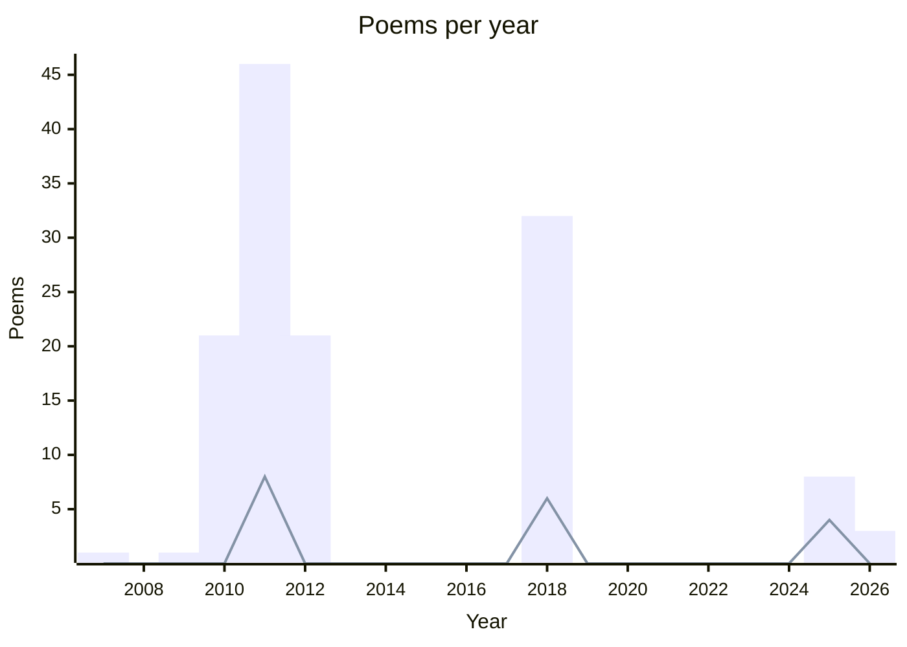

# 🖋️ Literature

## 💌 Poems

### Summary

**Total:** 133  
**Drafts:** 16  
**Favorites:** 18  
**Languages:**

- English 🇬🇧: 6
- French 🇫🇷: 127

### Poem list

- Joie de la découverte, [↗️](./poems/2026-01-30-joie-de-la-decouverte.md)
- Deuxième passage, [↗️](./poems/2026-01-30-deuxieme-passage.md)
- Ligne 1, [↗️](./poems/2026-01-29-ligne-1.md)
- With you, [↗️](./poems/2025-with-you.md) ✂︎
- Simple life, [↗️](./poems/2025-simple-life.md) ⭐
- Parle-moi, [↗️](./poems/2025-parle-moi.md) ✂︎
- Horaire de danse ?, [↗️](./poems/2025-horaire-de-danse.md)
- Fais-moi plaisir, [↗️](./poems/2025-fais-mois-plaisir.md) ✂︎ ⭐
- Euphonie, [↗️](./poems/2025-euphonie.md) ⭐
- A cat in the corner, [↗️](./poems/2025-cat-corner.md) ✂︎
- The wind is all I need, [↗️](./poems/2025-07-the-wind-is-all-i-need.md) ⭐
- Soyons ivre toujours, [↗️](./poems/2018-soyons-ivre-toujours.md) ✂︎
- Silence, [↗️](./poems/2018-silence.md) ⭐
- Si je devais être pris de court, [↗️](./poems/2018-si-je-devais-etre-pris-de-court.md) ⭐
- Seul comme dans un terminus, [↗️](./poems/2018-seul-comme-dans-un-terminus.md) ✂︎
- Santé !, [↗️](./poems/2018-sante.md)
- Saint Jean, [↗️](./poems/2018-saint-jean.md) ⭐
- Retour au bercail, [↗️](./poems/2018-retour-au-bercail.md)
- Quelques briques, [↗️](./poems/2018-quelques-briques.md) ✂︎
- Que veux-tu que je te dise ?, [↗️](./poems/2018-que-veux-tu-que-je-te-dise.md) ✂︎
- Pardonne-moi, pardonne-nous, [↗️](./poems/2018-pardonne-moi.md)
- On lit mes petits vers, [↗️](./poems/2018-on-lit-mes-petits-vers.md) ✂︎
- Ma Réputation, [↗️](./poems/2018-ma-reputation.md)
- Ma barbe me gratte, [↗️](./poems/2018-ma-barbe-me-gratte.md) ✂︎
- Léger syndrome de la page blanche, [↗️](./poems/2018-leger-syndrome-de-la-page-banche.md) ✂︎
- La Victoire de Samothrace, [↗️](./poems/2018-la-victoire-de-samosthrace.md) ⭐
- La Politique, [↗️](./poems/2018-la-politique.md)
- La page blanche, c'est celle des débuts, [↗️](./poems/2018-la-page-blanche.md) ✂︎
- Journée sombre, [↗️](./poems/2018-journee-sombre.md)
- Je te demande pardon, [↗️](./poems/2018-je-te-demande-pardon.md) ✂︎
- Je suis fumasse, [↗️](./poems/2018-je-suis-fumasse.md)
- J'aime être en colère, [↗️](./poems/2018-j-aime-etre-en-colere.md) ⭐
- J'ai quitté la campagne, [↗️](./poems/2018-j-ai-quitte-la-campagne.md)
- Gentils, [↗️](./poems/2018-gentils.md)
- Entre le train, [↗️](./poems/2018-entre-le-train.md)
- Écrire quelques mots pour un frère, [↗️](./poems/2018-ecrire-quelques-mots-pour-un-frere.md) ⭐
- Demoiselles mondaines, [↗️](./poems/2018-demoiselles-mondaines.md)
- Coup de pied au derrière, [↗️](./poems/2018-coup-de-pied.md)
- Bien chère demoiselle, [↗️](./poems/2018-bien-chere-demoiselle.md) ✂︎
- Belle Hirondelle, [↗️](./poems/2018-belle-hirondelle.md) ✂︎
- Appelle-moi, dis-moi n'importe quoi, [↗️](./poems/2018-appelle-moi.md)
- Ah ! Voilà qui est dur, [↗️](./poems/2018-ah-voila-qui-est-dur.md) ✂︎
- Carnet n°2, [↗️](./poems/2018-05-13-carnet-n-2.md)
- Sur des billets - Suite n° 4 - Billet 5000, [↗️](./poems/2012-billet-4-5000.md)
- Sur des billets - Suite n° 3 - Billet 100, [↗️](./poems/2012-billet-3-100.md)
- Sur des billets - Suite n° 2 - Billet 5, [↗️](./poems/2012-billet-2-5.md)
- Sur des billets - Suite n° 2 - Billet 40, [↗️](./poems/2012-billet-2-40.md)
- Sur des billets - Suite n° 2 - Billet 35, [↗️](./poems/2012-billet-2-35.md)
- Sur des billets - Suite n° 2 - Billet 30, [↗️](./poems/2012-billet-2-30.md)
- Sur des billets - Suite n° 2 - Billet 25, [↗️](./poems/2012-billet-2-25.md)
- Sur des billets - Suite n° 2 - Billet 20, [↗️](./poems/2012-billet-2-20.md)
- Sur des billets - Suite n° 2 - Billet 15, [↗️](./poems/2012-billet-2-15.md)
- Sur des billets - Suite n° 2 - Billet 10, [↗️](./poems/2012-billet-2-10.md)
- Sur des billets - Suite n° 1 - Billet 9, [↗️](./poems/2012-billet-1-9.md)
- Sur des billets - Suite n° 1 - Billet 8, [↗️](./poems/2012-billet-1-8.md)
- Sur des billets - Suite n° 1 - Billet 7, [↗️](./poems/2012-billet-1-7.md)
- Sur des billets - Suite n° 1 - Billet 6, [↗️](./poems/2012-billet-1-6.md)
- Sur des billets - Suite n° 1 - Billet 5, [↗️](./poems/2012-billet-1-5.md)
- Sur des billets - Suite n° 1 - Billet 4, [↗️](./poems/2012-billet-1-4.md)
- Sur des billets - Suite n° 1 - Billet 3, [↗️](./poems/2012-billet-1-3.md)
- Sur des billets - Suite n° 1 - Billet 2, [↗️](./poems/2012-billet-1-2.md)
- Sur des billets - Suite n° 1 - Billet 10, [↗️](./poems/2012-billet-1-10.md)
- Sur des billets - Suite n° 1 - Billet 1, [↗️](./poems/2012-billet-1-1.md)
- Naïvement, [↗️](./poems/2012-03-06-naivement.md)
- Liberté chérie, [↗️](./poems/2011-12-05-liberte-cherie.md)
- Infos, [↗️](./poems/2011-07-19-infos.md) ⭐
- Immobiles stagnants, [↗️](./poems/2011-07-07-immibiles-stagnants.md)
- Des Visages, [↗️](./poems/2011-07-07-des-visages.md)
- Nettoyage de Printemps, [↗️](./poems/2011-06-nettoyage-de-printemps.md)
- Idée pyromane, [↗️](./poems/2011-06-idee-pyromane.md)
- À quel moment peut-on se dire poète ?, [↗️](./poems/2011-06-a-quel-moment.md)
- Le Printemps estival, [↗️](./poems/2011-06-16-le-printemps-estival.md) ⭐
- La Mort, [↗️](./poems/2011-06-02-la-mort.md)
- La Mouette, [↗️](./poems/2011-05-29-la-mouette.md)
- Vie, [↗️](./poems/2011-05-28-vie.md)
- Le Feu sacré, [↗️](./poems/2011-05-28-le-feu-sacre.md)
- Idem, [↗️](./poems/2011-05-28-idem.md)
- Warning - _imposed tweak on [Jenny Joseph's Warning](https://www.scottishpoetrylibrary.org.uk/poem/warning/)_, [↗️](./poems/2011-05-24-warning.md) ⭐
- La Chute reconnaissable, [↗️](./poems/2011-04-13-la-chute-reconnaissable.md)
- Union, [↗️](./poems/2011-04-12-union.md)
- Idées, [↗️](./poems/2011-04-11-idees.md)
- T.A.A.F., [↗️](./poems/2011-04-10-taaf.md)
- Fuite ensorcelée, [↗️](./poems/2011-04-05-fuite-ensorcelee.md)
- La Facture, [↗️](./poems/2011-03-30-la-facture.md)
- Épicée, [↗️](./poems/2011-03-30-epicee.md)
- Le Poème, [↗️](./poems/2011-03-29-le-poeme.md)
- Perdu, [↗️](./poems/2011-03-28-perdu.md)
- Métamorphose, [↗️](./poems/2011-03-23-metamorphose.md)
- Autre Dessins, [↗️](./poems/2011-03-22-autres-dessins.md)
- Le Temps, [↗️](./poems/2011-03-17-le-temps.md)
- Pollution, [↗️](./poems/2011-03-14-pollution.md)
- Une Semaine, [↗️](./poems/2011-03-13-une-semaine.md) ⭐
- Dessins, [↗️](./poems/2011-03-13-dessins.md)
- Incompréhension, [↗️](./poems/2011-03-11-incomprehension.md)
- Anagramme, [↗️](./poems/2011-03-10-anagramme.md)
- Acrostiche, [↗️](./poems/2011-03-10-acrostiche.md)
- Soleil - _subject chosen by Cyrielle G_, [↗️](./poems/2011-03-09-soleil.md) ⭐
- Sex - _subject chosen by Maxime B_, [↗️](./poems/2011-03-08-sex.md) ⭐
- Désespoir - _subject chosen by Jordy M_, [↗️](./poems/2011-03-08-desespoir.md) ⭐
- Le Rêve, [↗️](./poems/2011-03-07-le-reve.md)
- Limites, [↗️](./poems/2011-02-26-limites.md)
- Choisir, [↗️](./poems/2011-02-20-choisir.md)
- Berthollet, [↗️](./poems/2011-02-18-berthollet.md)
- Paix intérieure, [↗️](./poems/2011-02-16-paix-interieure.md) ⭐
- Espoir et Désespoir, [↗️](./poems/2011-02-13-espoir-et-desespoir.md)
- Le Nain, [↗️](./poems/2011-02-09-le-nain.md)
- Désirs d'ailleurs, [↗️](./poems/2011-02-09-desirs-d-ailleurs.md)
- Écriture différente, [↗️](./poems/2011-02-07-ecriture-differente.md)
- La Bride, [↗️](./poems/2011-01-19-la-bride.md)
- La Maladie, [↗️](./poems/2011-01-05-la-maladie.md)
- La Volonté, [↗️](./poems/2010-12-22-la-volonte.md)
- Les Deux Faces, [↗️](./poems/2010-12-02-les-deux-faces.md)
- Un Pont, [↗️](./poems/2010-11-18-un-pont.md)
- Les Problèmes, [↗️](./poems/2010-11-15-les-problemes.md)
- La Perle et la Coquille, [↗️](./poems/2010-11-14-la-perle-et-la-coquille.md)
- Ombre et Reflet, [↗️](./poems/2010-10-27-ombre-et-reflet.md)
- Le Poète, [↗️](./poems/2010-10-27-le-poete.md)
- In English, [↗️](./poems/2010-10-27-in-english.md)
- L'Immortel Ennemi, [↗️](./poems/2010-10-25-l-immortel-ennemi.md)
- Imaginer, [↗️](./poems/2010-10-18-imaginer.md)
- Les Canapés, [↗️](./poems/2010-10-16-les-canapes.md)
- Un Imbécile, [↗️](./poems/2010-10-10-un-imbecile.md)
- Les Chevaliers voleurs, [↗️](./poems/2010-10-10-les-chevaliers-voleurs.md)
- L'Amour, [↗️](./poems/2010-10-10-l-amour.md)
- L'Écriture au stylo, [↗️](./poems/2010-10-03-l-ecriture-au-stylo.md)
- Écriture, [↗️](./poems/2010-10-03-ecriture.md)
- Dieu, [↗️](./poems/2010-10-03-dieu.md)
- Hésitation, [↗️](./poems/2010-09-29-hesitation.md)
- L'Écriture impossible, [↗️](./poems/2010-09-18-l-ecriture-impossible.md)
- L'Amour aveugle, [↗️](./poems/2010-09-18-l-amour-aveugle.md)
- Solitude, [↗️](./poems/2010-06-solitude.md)
- Les Larmes, [↗️](./poems/2009-11-les-larmes.md)
- Mon amour ma déchirure, [↗️](./poems/2007-mon-amour-ma-dechirure.md)
