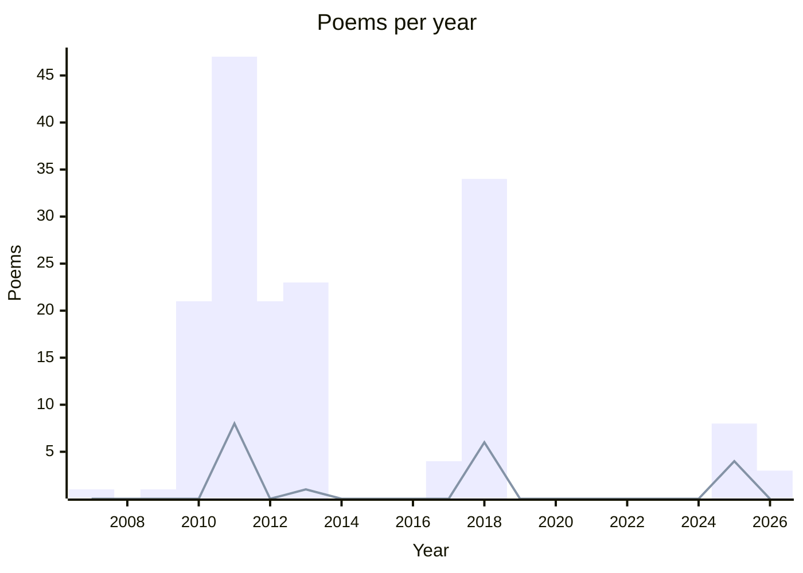
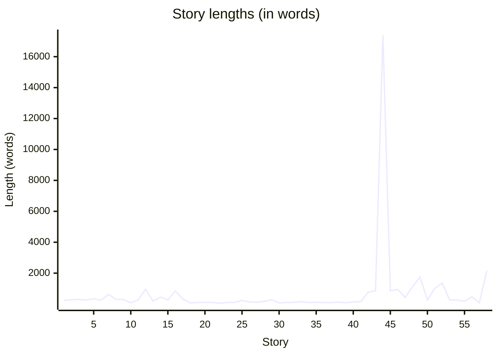

# 🖋️ Literature

## 💌 Poems

### Summary

**Total:** 163  
**Drafts:** 18  
**Favorites:** 19  
**Languages:**

- English 🇬🇧: 8
- French 🇫🇷: 154

### Poem list

- Joie de la découverte, [↗️](./poems/2026-01-30-joie-de-la-decouverte.md)
- Deuxième passage, [↗️](./poems/2026-01-30-deuxieme-passage.md)
- Ligne 1, [↗️](./poems/2026-01-29-ligne-1.md)
- With you, [↗️](./poems/2025-with-you.md) ✂︎
- Simple life, [↗️](./poems/2025-simple-life.md)  ⭐
- Parle-moi, [↗️](./poems/2025-parle-moi.md) ✂︎
- Horaire de danse ?, [↗️](./poems/2025-horaire-de-danse.md)
- Fais-moi plaisir, [↗️](./poems/2025-fais-mois-plaisir.md) ✂︎  ⭐
- Euphonie, [↗️](./poems/2025-euphonie.md)  ⭐
- A cat in the corner, [↗️](./poems/2025-cat-corner.md) ✂︎
- The wind is all I need, [↗️](./poems/2025-07-the-wind-is-all-i-need.md)  ⭐
- Soyons ivre toujours, [↗️](./poems/2018-soyons-ivre-toujours.md) ✂︎
- Silence, [↗️](./poems/2018-silence.md)  ⭐
- Si je devais être pris de court, [↗️](./poems/2018-si-je-devais-etre-pris-de-court.md)  ⭐
- Seul comme dans un terminus, [↗️](./poems/2018-seul-comme-dans-un-terminus.md) ✂︎
- Santé !, [↗️](./poems/2018-sante.md)
- Saint Jean, [↗️](./poems/2018-saint-jean.md)  ⭐
- Retour au bercail, [↗️](./poems/2018-retour-au-bercail.md)
- Quelques briques, [↗️](./poems/2018-quelques-briques.md) ✂︎
- Que veux-tu que je te dise ?, [↗️](./poems/2018-que-veux-tu-que-je-te-dise.md) ✂︎
- Pardonne-moi, pardonne-nous, [↗️](./poems/2018-pardonne-moi.md)
- On lit mes petits vers, [↗️](./poems/2018-on-lit-mes-petits-vers.md) ✂︎
- Ma Réputation, [↗️](./poems/2018-ma-reputation.md)
- Ma barbe me gratte, [↗️](./poems/2018-ma-barbe-me-gratte.md) ✂︎
- Léger syndrome de la page blanche, [↗️](./poems/2018-leger-syndrome-de-la-page-banche.md) ✂︎
- La Victoire de Samothrace, [↗️](./poems/2018-la-victoire-de-samosthrace.md)  ⭐
- La Politique, [↗️](./poems/2018-la-politique.md)
- La page blanche, c'est celle des débuts, [↗️](./poems/2018-la-page-blanche.md) ✂︎
- Journée sombre, [↗️](./poems/2018-journee-sombre.md)
- Je te demande pardon, [↗️](./poems/2018-je-te-demande-pardon.md) ✂︎
- Je suis fumasse, [↗️](./poems/2018-je-suis-fumasse.md)
- J'aime être en colère, [↗️](./poems/2018-j-aime-etre-en-colere.md)  ⭐
- J'ai quitté la campagne, [↗️](./poems/2018-j-ai-quitte-la-campagne.md)
- Gentils, [↗️](./poems/2018-gentils.md)
- Entre le train, [↗️](./poems/2018-entre-le-train.md)
- Écrire quelques mots pour un frère, [↗️](./poems/2018-ecrire-quelques-mots-pour-un-frere.md)  ⭐
- Demoiselles mondaines, [↗️](./poems/2018-demoiselles-mondaines.md)
- Coup de pied au derrière, [↗️](./poems/2018-coup-de-pied.md)
- Bien chère demoiselle, [↗️](./poems/2018-bien-chere-demoiselle.md) ✂︎
- Belle Hirondelle, [↗️](./poems/2018-belle-hirondelle.md) ✂︎
- Aujourd'hui est un grand jour, [↗️](./poems/2018-aujourd-hui-est-un-grand-jour.md) ✂︎
- Appelle-moi, dis-moi n'importe quoi, [↗️](./poems/2018-appelle-moi.md)
- Ah ! Voilà qui est dur, [↗️](./poems/2018-ah-voila-qui-est-dur.md) ✂︎
- Description Tinder, [↗️](./poems/2018-08-14-description-tinder.md)
- Carnet n°2, [↗️](./poems/2018-05-13-carnet-n-2.md)
- Challengez-moi, [↗️](./poems/2017-06-11-challengez-moi.md)
- J'essaye de ne pas y penser, [↗️](./poems/2017-05-09-j-essaye-de-ne-pas-y-penser.md)
- Mentir, se mentir, [↗️](./poems/2017-04-22-mentir-se-mentir.md)
- J'ai envie de fuir, [↗️](./poems/2017-03-17-j-ai-envie-de-fuir.md)
- Vue et Entendue, [↗️](./poems/2013-vue-et-entendue.md)
- Volonté ?, [↗️](./poems/2013-volonte.md)
- Vagabondant, [↗️](./poems/2013-vagabondant.md)
- Universe, [↗️](./poems/2013-universe.md)
- Un tube de colle, [↗️](./poems/2013-un-tube-de-colle.md)
- Suicide in Snow, [↗️](./poems/2013-suicide-in-snow.md)
- Serpentine Gallery, [↗️](./poems/2013-serpentine-gallery.md)
- Rouge Sang, [↗️](./poems/2013-rouge-sang.md)
- Quand je la regarde, [↗️](./poems/2013-quand-je-la-regarde.md)
- Nous héros - _extrait des [Maudits](../stories/les-maudits.md)_, [↗️](./poems/2013-nous-heros.md)
- Mer Grand, [↗️](./poems/2013-mer-grand.md)
- Lille, [↗️](./poems/2013-lille.md)
- Le Travail, [↗️](./poems/2013-le-travail.md)
- Juste une envie de hurler, [↗️](./poems/2013-juste-une-envie-de-hurler.md)
- Humain, [↗️](./poems/2013-humain.md)
- Damoiselles (2), [↗️](./poems/2013-damoiselles-2.md)
- Damoiselles, [↗️](./poems/2013-damoiselles-1.md)
- Compris, [↗️](./poems/2013-compris.md)
- Citadin, [↗️](./poems/2013-citadin.md)
- Chaque jour, je la rencontre, [↗️](./poems/2013-chaque-jour-je-la-rencontre.md)
- Au milieu d'une foule, [↗️](./poems/2013-au-milieu-d-une-foule.md)
- As your desire, [↗️](./poems/2013-as-your-desire.md)
- À la bonne heure, [↗️](./poems/2013-a-la-bonne-heure.md)  ⭐
- Sur des billets - Suite n° 4 - Billet 5000, [↗️](./poems/2012-billet-4-5000.md)
- Sur des billets - Suite n° 3 - Billet 100, [↗️](./poems/2012-billet-3-100.md)
- Sur des billets - Suite n° 2 - Billet 5, [↗️](./poems/2012-billet-2-5.md)
- Sur des billets - Suite n° 2 - Billet 40, [↗️](./poems/2012-billet-2-40.md)
- Sur des billets - Suite n° 2 - Billet 35, [↗️](./poems/2012-billet-2-35.md)
- Sur des billets - Suite n° 2 - Billet 30, [↗️](./poems/2012-billet-2-30.md)
- Sur des billets - Suite n° 2 - Billet 25, [↗️](./poems/2012-billet-2-25.md)
- Sur des billets - Suite n° 2 - Billet 20, [↗️](./poems/2012-billet-2-20.md)
- Sur des billets - Suite n° 2 - Billet 15, [↗️](./poems/2012-billet-2-15.md)
- Sur des billets - Suite n° 2 - Billet 10, [↗️](./poems/2012-billet-2-10.md)
- Sur des billets - Suite n° 1 - Billet 9, [↗️](./poems/2012-billet-1-9.md)
- Sur des billets - Suite n° 1 - Billet 8, [↗️](./poems/2012-billet-1-8.md)
- Sur des billets - Suite n° 1 - Billet 7, [↗️](./poems/2012-billet-1-7.md)
- Sur des billets - Suite n° 1 - Billet 6, [↗️](./poems/2012-billet-1-6.md)
- Sur des billets - Suite n° 1 - Billet 5, [↗️](./poems/2012-billet-1-5.md)
- Sur des billets - Suite n° 1 - Billet 4, [↗️](./poems/2012-billet-1-4.md)
- Sur des billets - Suite n° 1 - Billet 3, [↗️](./poems/2012-billet-1-3.md)
- Sur des billets - Suite n° 1 - Billet 2, [↗️](./poems/2012-billet-1-2.md)
- Sur des billets - Suite n° 1 - Billet 10, [↗️](./poems/2012-billet-1-10.md)
- Sur des billets - Suite n° 1 - Billet 1, [↗️](./poems/2012-billet-1-1.md)
- Naïvement, [↗️](./poems/2012-03-06-naivement.md)
- Liberté chérie, [↗️](./poems/2011-12-05-liberte-cherie.md)
- Infos, [↗️](./poems/2011-07-19-infos.md)  ⭐
- Plus classiques sont les réformateurs, [↗️](./poems/2011-07-07-plus-classiques.md) ✂︎
- Immobiles stagnants, [↗️](./poems/2011-07-07-immibiles-stagnants.md)
- Des Visages, [↗️](./poems/2011-07-07-des-visages.md)
- Nettoyage de Printemps, [↗️](./poems/2011-06-nettoyage-de-printemps.md)
- Idée pyromane, [↗️](./poems/2011-06-idee-pyromane.md)
- À quel moment peut-on se dire poète ?, [↗️](./poems/2011-06-a-quel-moment.md)
- Le Printemps estival, [↗️](./poems/2011-06-16-le-printemps-estival.md)  ⭐
- La Mort, [↗️](./poems/2011-06-02-la-mort.md)
- La Mouette, [↗️](./poems/2011-05-29-la-mouette.md)
- Vie, [↗️](./poems/2011-05-28-vie.md)
- Le Feu sacré, [↗️](./poems/2011-05-28-le-feu-sacre.md)
- Idem, [↗️](./poems/2011-05-28-idem.md)
- Warning - _imposed tweak on [Jenny Joseph's Warning](https://www.scottishpoetrylibrary.org.uk/poem/warning/)_, [↗️](./poems/2011-05-24-warning.md)  ⭐
- La Chute reconnaissable, [↗️](./poems/2011-04-13-la-chute-reconnaissable.md)
- Union, [↗️](./poems/2011-04-12-union.md)
- Idées, [↗️](./poems/2011-04-11-idees.md)
- T.A.A.F., [↗️](./poems/2011-04-10-taaf.md)
- Fuite ensorcelée, [↗️](./poems/2011-04-05-fuite-ensorcelee.md)
- La Facture, [↗️](./poems/2011-03-30-la-facture.md)
- Épicée, [↗️](./poems/2011-03-30-epicee.md)
- Le Poème, [↗️](./poems/2011-03-29-le-poeme.md)
- Perdu, [↗️](./poems/2011-03-28-perdu.md)
- Métamorphose, [↗️](./poems/2011-03-23-metamorphose.md)
- Autre Dessins, [↗️](./poems/2011-03-22-autres-dessins.md)
- Le Temps, [↗️](./poems/2011-03-17-le-temps.md)
- Pollution, [↗️](./poems/2011-03-14-pollution.md)
- Une Semaine, [↗️](./poems/2011-03-13-une-semaine.md)  ⭐
- Dessins, [↗️](./poems/2011-03-13-dessins.md)
- Incompréhension, [↗️](./poems/2011-03-11-incomprehension.md)
- Anagramme, [↗️](./poems/2011-03-10-anagramme.md)
- Acrostiche, [↗️](./poems/2011-03-10-acrostiche.md)
- Soleil - _subject chosen by Cyrielle G_, [↗️](./poems/2011-03-09-soleil.md)  ⭐
- Sex - _subject chosen by Maxime B_, [↗️](./poems/2011-03-08-sex.md)  ⭐
- Désespoir - _subject chosen by Jordy M_, [↗️](./poems/2011-03-08-desespoir.md)  ⭐
- Le Rêve, [↗️](./poems/2011-03-07-le-reve.md)
- Limites, [↗️](./poems/2011-02-26-limites.md)
- Choisir, [↗️](./poems/2011-02-20-choisir.md)
- Berthollet, [↗️](./poems/2011-02-18-berthollet.md)
- Paix intérieure, [↗️](./poems/2011-02-16-paix-interieure.md)  ⭐
- Espoir et Désespoir, [↗️](./poems/2011-02-13-espoir-et-desespoir.md)
- Le Nain, [↗️](./poems/2011-02-09-le-nain.md)
- Désirs d'ailleurs, [↗️](./poems/2011-02-09-desirs-d-ailleurs.md)
- Écriture différente, [↗️](./poems/2011-02-07-ecriture-differente.md)
- La Bride, [↗️](./poems/2011-01-19-la-bride.md)
- La Maladie, [↗️](./poems/2011-01-05-la-maladie.md)
- La Volonté, [↗️](./poems/2010-12-22-la-volonte.md)
- Les Deux Faces, [↗️](./poems/2010-12-02-les-deux-faces.md)
- Un Pont, [↗️](./poems/2010-11-18-un-pont.md)
- Les Problèmes, [↗️](./poems/2010-11-15-les-problemes.md)
- La Perle et la Coquille, [↗️](./poems/2010-11-14-la-perle-et-la-coquille.md)
- Ombre et Reflet, [↗️](./poems/2010-10-27-ombre-et-reflet.md)
- Le Poète, [↗️](./poems/2010-10-27-le-poete.md)
- In English, [↗️](./poems/2010-10-27-in-english.md)
- L'Immortel Ennemi, [↗️](./poems/2010-10-25-l-immortel-ennemi.md)
- Imaginer, [↗️](./poems/2010-10-18-imaginer.md)
- Les Canapés, [↗️](./poems/2010-10-16-les-canapes.md)
- Un Imbécile, [↗️](./poems/2010-10-10-un-imbecile.md)
- Les Chevaliers voleurs, [↗️](./poems/2010-10-10-les-chevaliers-voleurs.md)
- L'Amour, [↗️](./poems/2010-10-10-l-amour.md)
- L'Écriture au stylo, [↗️](./poems/2010-10-03-l-ecriture-au-stylo.md)
- Écriture, [↗️](./poems/2010-10-03-ecriture.md)
- Dieu, [↗️](./poems/2010-10-03-dieu.md)
- Hésitation, [↗️](./poems/2010-09-29-hesitation.md)
- L'Écriture impossible, [↗️](./poems/2010-09-18-l-ecriture-impossible.md)
- L'Amour aveugle, [↗️](./poems/2010-09-18-l-amour-aveugle.md)
- Solitude, [↗️](./poems/2010-06-solitude.md)
- Les Larmes, [↗️](./poems/2009-11-les-larmes.md)
- Mon amour ma déchirure, [↗️](./poems/2007-mon-amour-ma-dechirure.md)

## 📖 Stories

### Summary

**Total:** 58  
**Drafts:** 9  
**Favorites:** 0  
**Languages:**

- English 🇬🇧: 1
- French 🇫🇷: 57

### Story list

- Briques: Bruits, [↗️](./stories/briques-bruits.md)   (243 words)
- Briques: Do It Now, [↗️](./stories/briques-do-it-now.md)   (281 words)
- Briques: En Daim, [↗️](./stories/briques-en-daim.md)   (304 words)
- Briques: L'Autruche, [↗️](./stories/briques-l-autruche.md)   (270 words)
- Briques: La Nuit, [↗️](./stories/briques-la-nuit.md)   (348 words)
- Briques: La Télé, [↗️](./stories/briques-la-tele.md)   (246 words)
- Briques: Le Pommier, [↗️](./stories/briques-le-pommier.md)   (633 words)
- Briques: Le Train, [↗️](./stories/briques-le-train.md)   (298 words)
- Briques: Lendemain, [↗️](./stories/briques-lendemain.md)   (306 words)
- Briques: Rêve, [↗️](./stories/briques-reve.md)   (80 words)
- Briques: Une Prise, [↗️](./stories/briques-une-prise.md)   (267 words)
- Chez moi, [↗️](./stories/chez-moi.md)   (964 words)
- Coupable, [↗️](./stories/coupable.md)   (195 words)
- StoryTime: Dave, [↗️](./stories/dave.md)   (450 words)
- Du Nerf, [↗️](./stories/du-nerf.md)   (268 words)
- Et comme d'habitude, [↗️](./stories/et-comme-d-habitude.md)   (845 words)
- Et is s'en furent allés, [↗️](./stories/et-ils-s-en-furent-alles.md) ✂︎   (339 words)
- Gnome, [↗️](./stories/gnome.md) ✂︎   (81 words)
- Hard Memory, [↗️](./stories/hard-memory.md) ✂︎   (100 words)
- IG Inspired: Cache-Cache - _inspired by [@roger_by](https://www.instagram.com/roger_by/)_, [↗️](./stories/ig-cache-cache.md)   (116 words)
- IG Inspired: Dans une grotte - _inspired by [@erubes1](https://www.instagram.com/erubes1/)_, [↗️](./stories/ig-dans-une-grotte.md)   (107 words)
- IG Inspired: Étoile filante - _inspired by [@ecoxgear](https://www.instagram.com/ecoxgear/)_, [↗️](./stories/ig-etoile-filante.md)   (57 words)
- IG Inspired: L'Apprenti - _inspired by Marsel van Oosten_, [↗️](./stories/ig-l-apprenti.md)   (101 words)
- IG Inspired: L'Entrée - _inspired by [@tharinrosa](https://www.instagram.com/tharinrosa/)_, [↗️](./stories/ig-l-entree.md)   (115 words)
- IG Inspired: L'homme dans le champ - _inspired by [@mikkolagerstedt](https://www.instagram.com/mikkolagerstedt/)_, [↗️](./stories/ig-l-homme-dans-un-champs.md)   (231 words)
- IG Inspired: L'Inondation - _inspired by Phoebe Rudomino_, [↗️](./stories/ig-l-inondation.md)   (134 words)
- IG Inspired: La Bonne Patte - _inspired by [@lexiesheartbeat](https://www.instagram.com/lexiesheartbeat/)_, [↗️](./stories/ig-la-bonne-patte.md)   (118 words)
- IG Inspired: La porte de la maison - _inspired by [@gettyphotography](https://www.instagram.com/gettyphotography)_, [↗️](./stories/ig-la-porte-de-la-maison.md)   (170 words)
- IG Inspired: La sirène - _inspired by [@driftingpixels](https://www.instagram.com/driftingpixels/)_, [↗️](./stories/ig-la-sirene.md)   (286 words)
- IG Inspired: La Sortie - _inspired by [@makenaboy_maui_](https://www.instagram.com/makenaboy_maui_/)_, [↗️](./stories/ig-la-sortie.md)   (73 words)
- IG Inspired: La Vague - _inspired by [@sam.vox](https://www.instagram.com/sam.vox/)_, [↗️](./stories/ig-la-vague.md)   (99 words)
- IG Inspired: Le Départ - _inspired by [@Vdpfreelancer](https://www.instagram.com/Vdpfreelancer/)_, [↗️](./stories/ig-le-depart.md)   (121 words)
- IG Inspired: Le Destrier - _inspired by [@Elena_Shumilova](https://www.instagram.com/Elena_Shumilova/)_, [↗️](./stories/ig-le-destrier.md)   (163 words)
- IG Inspired: Le Naufrage - _inspired by [@trevblvke](https://www.instagram.com/trevblvke/)_, [↗️](./stories/ig-le-naufrage.md)   (100 words)
- IG Inspired: Le Soupir - _inspired by [@pumpkintheraccoon](https://www.instagram.com/pumpkintheraccoon/)_, [↗️](./stories/ig-le-soupir.md)   (119 words)
- IG Inspired: Le Temple de Glace - _inspired by [@DanielKordan](https://www.instagram.com/danielkordan/)_, [↗️](./stories/ig-le-temple-de-glace.md)   (103 words)
- IG Inspired: Le Train - _inspired by [@DanielKordan](https://www.instagram.com/danielkordan/)_, [↗️](./stories/ig-le-train.md)   (92 words)
- IG Inspired: Mal de dos - _inspired by [@planet.eart](https://www.instagram.com/planet.eart/)_, [↗️](./stories/ig-mal-de-dos.md)   (132 words)
- IG Inspired: Plop! - _inspired by [@andrewtkearns](https://www.instagram.com/andrewtkearns/)_, [↗️](./stories/ig-plop.md)   (89 words)
- IG Inspired: Sur la route - _inspired by [@cully_kamisugi](https://www.instagram.com/cully_kamisugi/)_, [↗️](./stories/ig-sur-la-route.md)   (138 words)
- IG Inspired: Viser la Lune - _inspired by [@eye.c](https://www.instagram.com/eye.c/)_, [↗️](./stories/ig-viser-la-lune.md)   (155 words)
- J'ai peur, [↗️](./stories/j-ai-peur.md)   (767 words)
- Juste une envie d'être ailleurs, [↗️](./stories/juste-une-envie-d-etre-ailleurs.md)   (853 words)
- L'Ascension du Ciel, [↗️](./stories/l-ascension-du-ciel.md) ✂︎   (17390 words)
- Le papi qui voulait être papa, [↗️](./stories/le-papi-qui-voulait-etre-papa.md) ✂︎   (856 words)
- Le Retour du perdant, [↗️](./stories/le-retour-du-perdant.md)   (942 words)
- Le Voleur aux mains propres, [↗️](./stories/le-voleur-aux-mains-propres.md)   (432 words)
- Les Maudits, [↗️](./stories/les-maudits.md)   (1142 words)
- Passion, [↗️](./stories/passion.md) ✂︎   (1743 words)
- Peines, [↗️](./stories/peines.md)   (266 words)
- Prêt, [↗️](./stories/pret.md)   (1023 words)
- Qui a éteint la lumière ?, [↗️](./stories/qui-a-eteint-la-lumiere.md)   (1359 words)
- Rien à déclarer: Deux secondes, [↗️](./stories/ras-deux-secondes.md)   (266 words)
- Rien à déclarer: Une minute, [↗️](./stories/ras-une-minute.md)   (269 words)
- Rire est interdit, [↗️](./stories/rire-est-interdit.md) ✂︎   (180 words)
- Sériosite, [↗️](./stories/seriosite.md) ✂︎   (473 words)
- Shit Story, [↗️](./stories/shit-story.md) ✂︎   (83 words)
- Vous et Nous, [↗️](./stories/vous-et-nous.md)   (2156 words)
